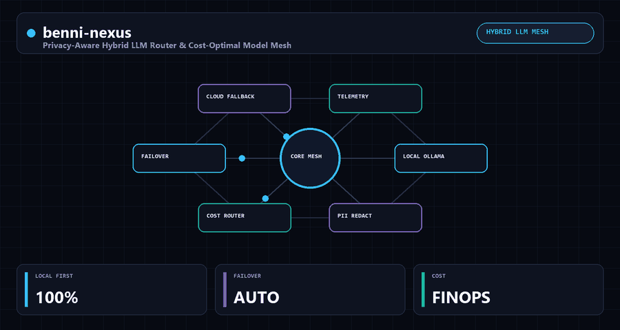

<div align="center">


<br/>


<br/><br/>

[](https://www.npmjs.com/package/benni-nexus)
[](https://github.com/benni-os/benni-nexus/actions)
[](https://www.typescriptlang.org/)
[](https://fastify.dev)
[](LICENSE)
[](https://benni-os.net)

<br/>

> **"One endpoint. All your LLMs. Zero hardcoding."**


<br/>



<br/>

</div>

<br/>

## ⭐ What Is benni-nexus?

**benni-nexus** is the intelligent LLM gateway of the **[Benni OS](https://github.com/benni-os)** ecosystem — a single OpenAI-compatible endpoint that routes, balances, and observes all your LLM backends automatically.

Every production AI stack ends up hardcoding different backends: local Ollama for dev, Groq for speed, OpenAI for quality. `benni-nexus` puts a single intelligent router in front of all of them.

```
Your App / Any SDK (OpenAI, LangChain, LlamaIndex, Vercel AI...)
         ↓ POST /v1/chat/completions (OpenAI-compatible)
    ┌─────────────────────────┐
    │      benni-nexus           │
    │   ┌────────────┐          │
    │   │   Router    │          │
    │   └─────┬─────┘          │
    └──────────│────────────┘
         ┬─────────┬────────┬
    Ollama   Groq    OpenAI   Gemini
   (local)  (fast)  (quality) (multi)
```

<br/>


## ⚡ Core Doctrine

> These are not settings. These are architecture laws.

| ☔ Principle | 🔧 Implementation |
|---|---|
| **Single Endpoint** | One `POST /v1/chat/completions` — every backend behind it, no app rewrites |
| **Strategy-Driven Routing** | `cheap-first` · `fast-first` · `quality-first` · `round-robin` · `failover` |
| **OpenAI-Compatible** | Drop-in for any SDK — LangChain, LlamaIndex, Vercel AI, AutoGen, CrewAI |
| **Local-First Option** | Ollama as first-class backend — zero cloud required for dev |
| **Observable by Default** | Prometheus metrics + per-backend health checks (v0.2 roadmap) |
| **Zero Lock-In** | Add or remove backends via config — no code changes, no redeployment |

<br/>


## 🚀 Quick Start

```bash
# Install globally
npm install -g benni-nexus

# Generate config
nexus init

# Start the gateway
nexus start
# ⚡ benni-nexus running on http://localhost:4000
```

Now **any** OpenAI-compatible client works out of the box:

```typescript
import OpenAI from 'openai';

const client = new OpenAI({
  baseURL: 'http://localhost:4000/v1',
  apiKey: 'nexus', // any string
});

const res = await client.chat.completions.create({
  model: 'auto', // benni-nexus picks the best backend
  messages: [{ role: 'user', content: 'Explain MCP in one paragraph.' }],
});
```

<br/>


## 🎯 Routing Strategies

| Strategy | Description | Best For |
|---|---|---|
| `cheap-first` | Local models first, cloud as fallback | Dev environments, cost-sensitive workloads |
| `fast-first` | Routes to lowest measured P50 latency | Real-time apps, chat UIs |
| `quality-first` | Routes to highest quality-scored backend | Production pipelines, summarization |
| `round-robin` | Even distribution across all backends | Load testing, equal-quality backends |
| `failover` | Primary with automatic fallback chain | High-availability production |

<br/>


## ⚙️ Configuration

```json
{
  "port": 4000,
  "strategy": "cheap-first",
  "backends": [
    { "name": "ollama", "type": "ollama", "url": "http://localhost:11434", "models": ["llama3.1:8b", "mistral:7b"] },
    { "name": "groq",   "type": "groq",   "apiKey": "$GROQ_API_KEY" },
    { "name": "openai", "type": "openai", "apiKey": "$OPENAI_API_KEY" },
    { "name": "gemini", "type": "gemini", "apiKey": "$GEMINI_API_KEY" }
  ]
}
```

<br/>


## 🔌 Supported Backends

| Backend | Type | Notes |
|---|---|---|
| **Ollama** | `ollama` | Local models — Llama, Mistral, Gemma, Phi, Qwen... |
| **Groq** | `groq` | Ultra-fast inference on Llama, Mixtral |
| **OpenAI** | `openai` | GPT-4o, GPT-4o-mini, o1... |
| **Google Gemini** | `gemini` | Gemini 2.0 Flash, Pro |
| **Anthropic** *(v0.3)* | `anthropic` | Claude 3.5, Claude 4... |
| **Custom** *(v0.3)* | `custom` | Any OpenAI-compatible endpoint |

<br/>


## 📊 Observability *(v0.2 roadmap)*

```
GET /metrics

nexus_requests_total{backend="ollama",status="success"} 1420
nexus_requests_total{backend="groq",status="success"} 380
nexus_latency_p50_ms{backend="ollama"} 142
nexus_latency_p50_ms{backend="groq"} 38
```

Prometheus metrics + per-backend health checks + live dashboard — coming in v0.2.

<br/>


## 🛠️ Development

```bash
git clone https://github.com/benni-os/benni-nexus
cd benni-nexus
npm install
npm run dev       # ts-node live reload
npm test          # vitest
npm run typecheck # tsc --noEmit
```

<br/>


## 🤝 Contributing

All contributions welcome. Check [good first issues](https://github.com/benni-os/benni-nexus/labels/good%20first%20issue) for beginner-friendly tasks.
See [CONTRIBUTING.md](CONTRIBUTING.md) for full guidelines.

<br/>


## 🌐 The Benni OS Open-Source Ecosystem

`benni-nexus` is part of the coordinated **Benni Master OS v9.4** open-source infrastructure suite:

| Repository | Focus & Architecture | Stars |
| :--- | :--- | :---: |
| **[`conductor-sdd`](https://github.com/Benni-OS/conductor-sdd)** | Zero-Dependency Spec-Driven Development, Static AST Drift Detector & MCP Guardrail | [](https://github.com/Benni-OS/conductor-sdd) |
| **[`benni-inference-engine`](https://github.com/Benni-OS/benni-inference-engine)** | High-Throughput Sovereign Local Inference for 8GB–16GB Consumer GPUs | [](https://github.com/Benni-OS/benni-inference-engine) |
| **[`agent-eval-harness`](https://github.com/BenniAlencar/agent-eval-harness)** | Deterministic Zero-Cloud Agent Evaluation, Red-Teaming & Benchmark Harness | [](https://github.com/BenniAlencar/agent-eval-harness) |
| **[`agent-code-sandbox`](https://github.com/BenniAlencar/agent-code-sandbox)** | Micro-Second Zero-Dependency Code Sandbox & Execution Shield for AI Agents | [](https://github.com/BenniAlencar/agent-code-sandbox) |
| **[`agent-deep-research`](https://github.com/BenniAlencar/agent-deep-research)** | Autonomous Multi-Source Deep Research & Evidence Synthesis Engine | [](https://github.com/BenniAlencar/agent-deep-research) |
| **[`agent-browser-mesh`](https://github.com/BenniAlencar/agent-browser-mesh)** | Token-Saving Resilient Headless Browser Automation & A11y DOM Compiler | [](https://github.com/BenniAlencar/agent-browser-mesh) |
| **[`agent-intent-compiler`](https://github.com/BenniAlencar/agent-intent-compiler)** | Deterministic Intent Compiler & Typed DAG Execution Planner for AI Agents | [](https://github.com/BenniAlencar/agent-intent-compiler) |
| **[`agent-token-optimizer`](https://github.com/BenniAlencar/agent-token-optimizer)** | Sub-Millisecond Context Compression & Semantic Deduplication Engine | [](https://github.com/BenniAlencar/agent-token-optimizer) |
| **[`bio-sync-operator-os`](https://github.com/BenniAlencar/bio-sync-operator-os)** | Real-Time Biometric Swarm Governance & 120 FPS Resonant Kinetic Interface | [](https://github.com/BenniAlencar/bio-sync-operator-os) |
| **[`agent-cyber-sentinel`](https://github.com/BenniAlencar/agent-cyber-sentinel)** | Zero-Trust Runtime Security, Prompt Injection Firewall & Secrets Redaction | [](https://github.com/BenniAlencar/agent-cyber-sentinel) |
| **[`agent-run-ledger`](https://github.com/BenniAlencar/agent-run-ledger)** | Deterministic Multi-Step Task Execution Ledger & Anti-Looping Engine | [](https://github.com/BenniAlencar/agent-run-ledger) |
| **[`reality-lock`](https://github.com/BenniAlencar/reality-lock)** | Cryptographic State Verification & Invariant Proof Engine for Agents | [](https://github.com/BenniAlencar/reality-lock) |
| **[`agent-memory-mesh`](https://github.com/BenniAlencar/agent-memory-mesh)** | Hybrid Vector + BM25 Hierarchical Session Memory & Continuity Engine | [](https://github.com/BenniAlencar/agent-memory-mesh) |
| **[`benni-operator-gateway`](https://github.com/Benni-OS/benni-operator-gateway)** | Human-in-the-Loop Approval & Policy Enforcement Gateway | [](https://github.com/Benni-OS/benni-operator-gateway) |
| **[`mcp-forge`](https://github.com/Benni-OS/mcp-forge)** | Rapid Model Context Protocol (MCP) Server Scaffolding & Dynamic Tooling | [](https://github.com/Benni-OS/mcp-forge) |
| **[`benni-nexus`](https://github.com/Benni-OS/benni-nexus)** | Autonomous Multi-Agent Intent Routing & Swarm Coordination Hub | [](https://github.com/Benni-OS/benni-nexus) |
| **[`community-autopilot`](https://github.com/Benni-OS/community-autopilot)** | Autonomous GitHub Community Triaging & PR Feedback Agent | [](https://github.com/Benni-OS/community-autopilot) |

---

## 🏛️ Commercial & Sovereign Architecture

Need autonomous multi-agent swarm orchestration, private datacenter infrastructure, or enterprise governance?

- **Official Website:** [https://benni-os.net](https://benni-os.net)
- **Operator Mode Playbook:** [https://benni-os.net/blog/academy.html](https://benni-os.net/blog/academy.html)
- **GitHub Organization:** [https://github.com/Benni-OS](https://github.com/Benni-OS)
- **Maintainer:** [Benni Alencar](https://github.com/BenniAlencar)

---

## 📄 License & Provenance

- **License:** [MIT License](LICENSE)
- **Author:** Benni Alencar (`bennialencar@benni-os.net`)
- **Architecture:** Benni Master OS v9.4 Tier-0 Governance Standard

<div align="center">


**benni-nexus** — *Open-Source LLM Gateway by [Benni OS](https://github.com/Benni-OS)* • [benni-os.net](https://benni-os.net) • `MIT License`

`SINGLE_ENDPOINT` • `STRATEGY_ROUTING` • `OPENAI_COMPATIBLE` • `LOCAL_FIRST` • `MIT_LICENSE`

Engineered by **Benni Alencar** and the Benni OS Core Engineering Group

</div>
