<div align="center">


<br/>


<br/><br/>

[](https://www.npmjs.com/package/benni-nexus)
[](https://github.com/benni-os/benni-nexus/actions)
[](https://www.typescriptlang.org/)
[](https://fastify.dev)
[](LICENSE)
[](https://github.com/benni-os)

<br/>

> **"One endpoint. All your LLMs. Zero hardcoding."**


<br/>



<br/>

</div>

<br/>

## ⭐ What Is benni-nexus?

**benni-nexus** is the intelligent LLM gateway of the **[Benni OS](https://github.com/benni-os)** ecosystem — a single OpenAI-compatible endpoint that routes, balances, and observes all your LLM backends automatically.

Every production AI stack ends up hardcoding different backends: local Ollama for dev, Groq for speed, OpenAI for quality. `benni-nexus` puts a single intelligent router in front of all of them.

```
Your App / Any SDK (OpenAI, LangChain, LlamaIndex, Vercel AI...)
         ↓ POST /v1/chat/completions (OpenAI-compatible)
    ┌─────────────────────────┐
    │      benni-nexus           │
    │   ┌────────────┐          │
    │   │   Router    │          │
    │   └─────┬─────┘          │
    └──────────│────────────┘
         ┬─────────┬────────┬
    Ollama   Groq    OpenAI   Gemini
   (local)  (fast)  (quality) (multi)
```

<br/>


## ⚡ Core Doctrine

> These are not settings. These are architecture laws.

| ☔ Principle | 🔧 Implementation |
|---|---|
| **Single Endpoint** | One `POST /v1/chat/completions` — every backend behind it, no app rewrites |
| **Strategy-Driven Routing** | `cheap-first` · `fast-first` · `quality-first` · `round-robin` · `failover` |
| **OpenAI-Compatible** | Drop-in for any SDK — LangChain, LlamaIndex, Vercel AI, AutoGen, CrewAI |
| **Local-First Option** | Ollama as first-class backend — zero cloud required for dev |
| **Observable by Default** | Prometheus metrics + per-backend health checks (v0.2 roadmap) |
| **Zero Lock-In** | Add or remove backends via config — no code changes, no redeployment |

<br/>


## 🚀 Quick Start

```bash
# Install globally
npm install -g benni-nexus

# Generate config
nexus init

# Start the gateway
nexus start
# ⚡ benni-nexus running on http://localhost:4000
```

Now **any** OpenAI-compatible client works out of the box:

```typescript
import OpenAI from 'openai';

const client = new OpenAI({
  baseURL: 'http://localhost:4000/v1',
  apiKey: 'nexus', // any string
});

const res = await client.chat.completions.create({
  model: 'auto', // benni-nexus picks the best backend
  messages: [{ role: 'user', content: 'Explain MCP in one paragraph.' }],
});
```

<br/>


## 🎯 Routing Strategies

| Strategy | Description | Best For |
|---|---|---|
| `cheap-first` | Local models first, cloud as fallback | Dev environments, cost-sensitive workloads |
| `fast-first` | Routes to lowest measured P50 latency | Real-time apps, chat UIs |
| `quality-first` | Routes to highest quality-scored backend | Production pipelines, summarization |
| `round-robin` | Even distribution across all backends | Load testing, equal-quality backends |
| `failover` | Primary with automatic fallback chain | High-availability production |

<br/>


## ⚙️ Configuration

```json
{
  "port": 4000,
  "strategy": "cheap-first",
  "backends": [
    { "name": "ollama", "type": "ollama", "url": "http://localhost:11434", "models": ["llama3.1:8b", "mistral:7b"] },
    { "name": "groq",   "type": "groq",   "apiKey": "$GROQ_API_KEY" },
    { "name": "openai", "type": "openai", "apiKey": "$OPENAI_API_KEY" },
    { "name": "gemini", "type": "gemini", "apiKey": "$GEMINI_API_KEY" }
  ]
}
```

<br/>


## 🔌 Supported Backends

| Backend | Type | Notes |
|---|---|---|
| **Ollama** | `ollama` | Local models — Llama, Mistral, Gemma, Phi, Qwen... |
| **Groq** | `groq` | Ultra-fast inference on Llama, Mixtral |
| **OpenAI** | `openai` | GPT-4o, GPT-4o-mini, o1... |
| **Google Gemini** | `gemini` | Gemini 2.0 Flash, Pro |
| **Anthropic** *(v0.3)* | `anthropic` | Claude 3.5, Claude 4... |
| **Custom** *(v0.3)* | `custom` | Any OpenAI-compatible endpoint |

<br/>


## 📊 Observability *(v0.2 roadmap)*

```
GET /metrics

nexus_requests_total{backend="ollama",status="success"} 1420
nexus_requests_total{backend="groq",status="success"} 380
nexus_latency_p50_ms{backend="ollama"} 142
nexus_latency_p50_ms{backend="groq"} 38
```

Prometheus metrics + per-backend health checks + live dashboard — coming in v0.2.

<br/>


## 🛠️ Development

```bash
git clone https://github.com/benni-os/benni-nexus
cd benni-nexus
npm install
npm run dev       # ts-node live reload
npm test          # vitest
npm run typecheck # tsc --noEmit
```

<br/>


## 🤝 Contributing

All contributions welcome. Check [good first issues](https://github.com/benni-os/benni-nexus/labels/good%20first%20issue) for beginner-friendly tasks.
See [CONTRIBUTING.md](CONTRIBUTING.md) for full guidelines.

<br/>


## 🌐 The Benni OS Ecosystem

`benni-nexus` is part of the **Benni OS** decentralized agentic architecture. The ecosystem is organized into modular **Public Open-Source Infrastructure** and **Proprietary Core Autonomous Systems**:

### 🔓 Public Open-Source Infrastructure

| Layer / Domain | Repository | Maintainer | Description | Status |
|---|---|---|---|---|
| **Security & Defense** | [**`agent-cyber-sentinel`**](https://github.com/BenniAlencar/agent-cyber-sentinel) | `@BenniAlencar` | Tier-0 Zero-Trust runtime security shield, prompt injection firewall & secret redactor. | 🟢 Stable (Apache-2.0) |
| **Execution & State** | [**`agent-run-ledger`**](https://github.com/BenniAlencar/agent-run-ledger) | `@BenniAlencar` | Resumable multi-step execution state machine, anti-loop circuit breaker & crash recovery. | 🟢 Stable (Apache-2.0) |
| **Long-Term Memory** | [**`agent-memory-mesh`**](https://github.com/BenniAlencar/agent-memory-mesh) | `@BenniAlencar` | Sovereign bi-temporal knowledge graph & episodic memory with multi-tenant isolation. | 🟢 Stable (Apache-2.0) |
| **Zero-Trust Verification** | [**`reality-lock`**](https://github.com/BenniAlencar/reality-lock) | `@BenniAlencar` | Cryptographic execution verification & signed SHA-256 evidence ledgers for side-effects. | 🟢 Stable (Apache-2.0) |
| **Autonomous Web Perception** | [**`agent-browser-mesh`**](https://github.com/BenniAlencar/agent-browser-mesh) | `@BenniAlencar` | High-speed, zero-token-waste autonomous browser engine with semantic DOM-Delta compaction & native MCP. | 🟢 Stable (Apache-2.0) |
| **MCP Tooling Matrix** | [**`mcp-forge`**](https://github.com/benni-os/mcp-forge) | `Benni-OS` | Rapid developer toolchain for building, validating, and publishing Model Context Protocol servers. | 🟢 Public OSS |
| **Local Hybrid Inference** | [**`benni-inference-engine`**](https://github.com/benni-os/benni-inference-engine) | `Benni-OS` | GPU+CPU MoE expert offloading runtime with Skill 81 Ceiling Extraction on consumer hardware. | 🟢 Public OSS |
| **Federated Execution** | [**`benni-operator-gateway`**](https://github.com/benni-os/benni-operator-gateway) | `Benni-OS` | Unified policy-governed operator gateway for dispatching actions across local and cloud environments. | 🟢 Public OSS |
| **Model Routing Hub** | [**`benni-nexus`**](https://github.com/benni-os/benni-nexus) | `Benni-OS` | Intelligent LLM model router optimizing for latency, cost, and task-specific reasoning ceilings. | 🟢 Public OSS |
| **Autonomous Community** | [**`community-autopilot`**](https://github.com/benni-os/community-autopilot) | `Benni-OS` | Autonomous event-driven community management, issue triage, and repository telemetry. | 🟢 Public OSS |

---

### 🔒 Proprietary Core & Autonomous Systems (Enterprise Benni OS)

The open-source stack serves as the decentralized foundation for the enterprise-grade Benni OS autonomous swarm kernel:

| System | Role & Scope | Architecture Doctrine | Access |
|---|---|---|---|
| **Benni Master OS** | Central operating system kernel v9.4 governing 43 canonical skills, runtime contracts, and swarm coordination. | `Universal Skills 00–100` | 🔒 Private Core |
| **Project Benjamin** | Sovereign autonomous execution orchestrator with typed handoff contracts and zero-human-in-the-loop loops. | `Skill 93 Autonomous Dispatch` | 🔒 Private Core |
| **Project Adam** | Agent synthesis, benchmark evaluation, and continuous recursive self-evolution engine. | `Skill 92 Self-Evolution` | 🔒 Private Core |
| **Benni Control Plane** | Distributed state persistence, atomic snapshot restore protocols, and multi-tenant ledger governance. | `Skill 90 Control Plane OS` | 🔒 Enterprise |
| **Benni Social Hub** | Multi-channel content authority distribution, attribution engine, and automated revenue funnels. | `Skill 52 & Skill 95 Revenue Loop` | 🔒 Enterprise |
| **Benni Canvas** | Autonomous UI engineering subsystem v14.0 delivering generative high-end motion and responsive dashboards. | `Skill 54 Open Design & Skill 56` | 🔒 Enterprise |
| **Benni Nemesis** | Federated integration gateway connecting cloud APIs, vector databases, and multi-cloud webhooks. | `Skill 97 Nemesis Gateway` | 🔒 Private Core |
| **Benni OS Genesis** | Structured prompt engineering compilation and generative knowledge distillation engine. | `Skill 70 Model Behavior` | 🔒 Private Core |

---

👉 **Explore & Connect with the Benni OS Ecosystem:**
* **Official Website**: [https://bennios.dev](https://bennios.dev)
* **Benni Operator Hub**: [https://hub.bennios.dev](https://hub.bennios.dev)
* **GitHub Organization**: [https://github.com/benni-os](https://github.com/benni-os)
* **Maintainer Profile**: [https://github.com/BenniAlencar](https://github.com/BenniAlencar)
* **Documentation & Blueprints**: [https://docs.bennios.dev](https://docs.bennios.dev)

<br/>


<div align="center">

**benni-nexus** — *Open-Source LLM Gateway by [Benni OS](https://github.com/benni-os)*

`SINGLE_ENDPOINT` • `STRATEGY_ROUTING` • `OPENAI_COMPATIBLE` • `LOCAL_FIRST` • `MIT_LICENSE`

Engineered by **Benni Alencar** and the Benni OS Core Engineering Group

</div>
